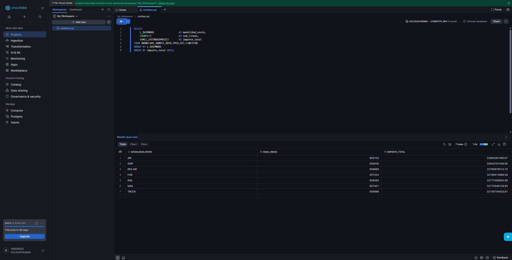
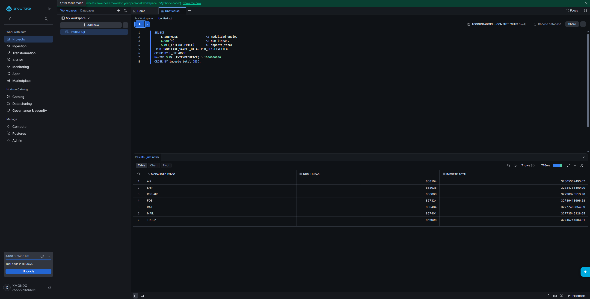
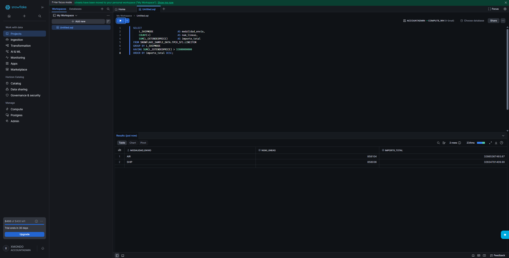
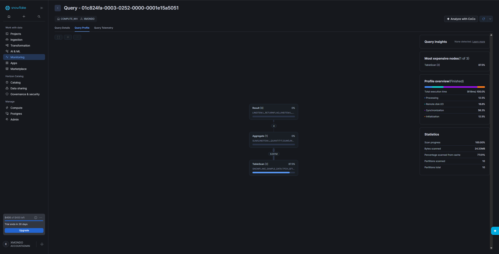
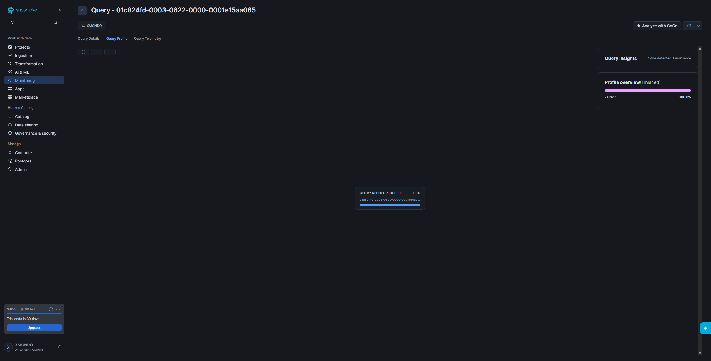

# Práctica Snowflake: agregaciones, Query Profile y caché

Autor: Álvaro García-Quismondo Lizana
Fecha: 2 de noviembre de 2026

Todas las consultas se ejecutan sobre la tabla `SNOWFLAKE_SAMPLE_DATA.TPCH_SF1.LINEITEM` desde Snowsight (Workspaces), con el rol ACCOUNTADMIN y el warehouse COMPUTE_WH (X-Small) de una cuenta de prueba. Los scripts de cada ejercicio están en la carpeta `scripts/` y las capturas en `img/`.

## Preparación

Al lanzar `SELECT COUNT(*) FROM LINEITEM` tras un `USE DATABASE` y un `USE SCHEMA` la consulta falló con el error "Object 'LINEITEM' does not exist or not authorized", porque el editor no tenía base de datos seleccionada. Con el nombre completo de la tabla funcionó y devolvió 6.001.215 filas. Por eso todas las consultas llevan el nombre cualificado `SNOWFLAKE_SAMPLE_DATA.TPCH_SF1.LINEITEM`.

## Ejercicio 1. Análisis de pedidos

Script: `scripts/ejercicio_1.sql`

```sql
SELECT
    L_SHIPMODE                 AS modalidad_envio,
    COUNT(*)                   AS num_lineas,
    SUM(L_EXTENDEDPRICE)       AS importe_total
FROM SNOWFLAKE_SAMPLE_DATA.TPCH_SF1.LINEITEM
GROUP BY L_SHIPMODE
ORDER BY importe_total DESC;
```



Figura 1. Líneas de pedido e importe total por modalidad de envío (7 filas).

1. La modalidad con el importe total más alto es AIR, con 32.865.367.493,67 sobre 858.104 líneas. Le siguen SHIP (32.834.781.409,90) y REG AIR (32.790.976.513,70). Las siete modalidades quedan entre 32.745 y 32.865 millones, así que la diferencia entre la primera y la última es inferior al 0,4 %.
2. `GROUP BY` agrupa las filas que comparten el mismo valor en las columnas indicadas y calcula las funciones de agregación (`COUNT`, `SUM`) una vez por grupo. Aquí devuelve una fila por cada valor distinto de `L_SHIPMODE`.
3. La tabla tiene 6.001.215 filas. Mostrarlas todas no permite sacar ninguna conclusión y obliga a mover mucho volumen de datos. Agregar reduce el resultado a siete filas comparables y hace que la información sea legible.

## Ejercicio 2. Modificar la consulta

Scripts: `scripts/ejercicio_2a_having_1000M.sql` y `scripts/ejercicio_2b_having_32800M.sql`

La consulta pedida añade `HAVING` con el umbral de 1.000 millones:

```sql
SELECT
    L_SHIPMODE                 AS modalidad_envio,
    COUNT(*)                   AS num_lineas,
    SUM(L_EXTENDEDPRICE)       AS importe_total
FROM SNOWFLAKE_SAMPLE_DATA.TPCH_SF1.LINEITEM
GROUP BY L_SHIPMODE
HAVING SUM(L_EXTENDEDPRICE) > 1000000000
ORDER BY importe_total DESC;
```



Figura 2. Con el umbral de 1.000 millones salen las siete modalidades, porque todas superan los 32.000 millones.

Como ese umbral no descarta ningún grupo, repetí la consulta con 32.800 millones para comprobar que el filtro actúa:

```sql
HAVING SUM(L_EXTENDEDPRICE) > 32800000000
```



Figura 3. Con 32.800 millones solo quedan AIR y SHIP.

1. La cláusula para filtrar grupos es `HAVING`.
2. `WHERE` filtra filas individuales antes de agrupar y no admite funciones de agregación. `HAVING` filtra grupos ya formados, después del `GROUP BY`, y sí puede usar agregaciones como `SUM(L_EXTENDEDPRICE)`.

## Ejercicio 3. Investigar la ejecución

Script: `scripts/ejercicio_3_query_profile.sql`

```sql
SELECT
    L_RETURNFLAG,
    L_LINESTATUS,
    SUM(L_QUANTITY)        AS cantidad_total,
    AVG(L_EXTENDEDPRICE)   AS precio_medio
FROM SNOWFLAKE_SAMPLE_DATA.TPCH_SF1.LINEITEM
GROUP BY L_RETURNFLAG, L_LINESTATUS;
```

El Query Profile se abre desde Monitoring > Query History, haciendo clic en el identificador de la consulta y entrando en la pestaña Query Profile.



Figura 4. Query Profile de la consulta (identificador 01c824fa-0003-0252-0000-0001e15a5051).

En la figura 4 el plan tiene tres operadores: TableScan, Aggregate y Result. El TableScan lee 6,001 millones de filas, el Aggregate las reduce a 4 y el Result las devuelve. La ejecución total fue de 618 ms y el TableScan concentra el 87,5 % del tiempo. Se escanearon 24,33 MB y 10 de las 10 micro-particiones de la tabla, con un 77,01 % de los datos leídos desde la caché del warehouse.

1. El Query Profile muestra el plan de ejecución como un grafo de operadores, con el porcentaje de tiempo de cada uno y las filas que pasan de un operador a otro. En el panel lateral añade la distribución del tiempo (procesamiento, I/O de disco remoto, sincronización, inicialización) y estadísticas como los bytes escaneados, las particiones escaneadas frente a las totales y el porcentaje leído de caché.
2. Que una consulta examine muchos bytes significa que lee mucho volumen de datos, lo que se traduce en más tiempo y más consumo de cómputo. Suele indicar que faltan filtros, que se seleccionan columnas innecesarias o que el pruning de micro-particiones es bajo. En esta consulta no hay filtro, por eso se escanean las 10 particiones de 10.
3. Visualizar las operaciones permite ver en qué operador se gasta el tiempo (aquí el TableScan), entender el orden de ejecución y detectar problemas como joins que multiplican filas o volcados a disco, para decidir qué optimizar.

## Ejercicio 4. Comprender la caché

Script: `scripts/ejercicio_4_cache.sql`

```sql
SELECT
    L_SHIPMODE,
    COUNT(*)           AS num_lineas,
    AVG(L_DISCOUNT)    AS descuento_medio
FROM SNOWFLAKE_SAMPLE_DATA.TPCH_SF1.LINEITEM
GROUP BY L_SHIPMODE;
```

Ejecuté la consulta dos veces seguidas sin modificar el texto ni los datos.


Figura 5. Query Profile de la primera ejecución (01c824fc-0003-0621-0000-0001e15ac045). Tiene TableScan, Aggregate y Result, tarda 957 ms de ejecución, escanea 5,47 MB y 10 de 10 particiones.



Figura 6. Query Profile de la segunda ejecución (01c824fd-0003-0622-0000-0001e15aa065). Solo aparece un nodo, Query Result Reuse, y no hay TableScan ni bytes escaneados.

1. Sí, la segunda ejecución puede ser más rápida. En mi caso el plan se reduce a un único nodo Query Result Reuse, sin leer la tabla.
2. La caché de resultados guarda el resultado de una consulta durante 24 horas. Si se lanza de nuevo la misma consulta y los datos subyacentes no han cambiado, Snowflake devuelve el resultado guardado sin ejecutar el plan ni leer micro-particiones. Es distinta de la caché del warehouse: en la figura 5 aparece un 46,87 % escaneado desde caché, que son datos ya presentes en el disco local del warehouse, y aun así la consulta recorre el TableScan completo.
3. No está garantizado. La reutilización exige que el texto de la consulta sea el mismo, que los datos de las tablas no hayan cambiado, que no hayan pasado 24 horas desde la ejecución original (el plazo se renueva cada vez que se reutiliza el resultado, hasta un máximo de 31 días) y que la consulta no contenga funciones no deterministas como `CURRENT_TIMESTAMP()`. Tampoco se reutiliza si el parámetro `USE_CACHED_RESULT` está desactivado o si cambian los privilegios del rol sobre las tablas.
